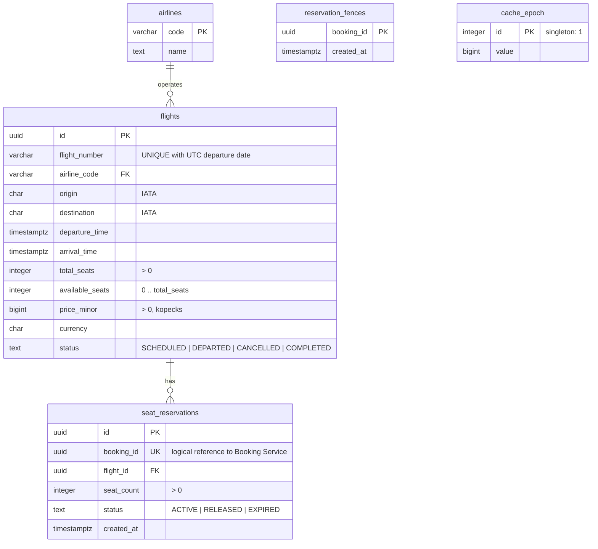
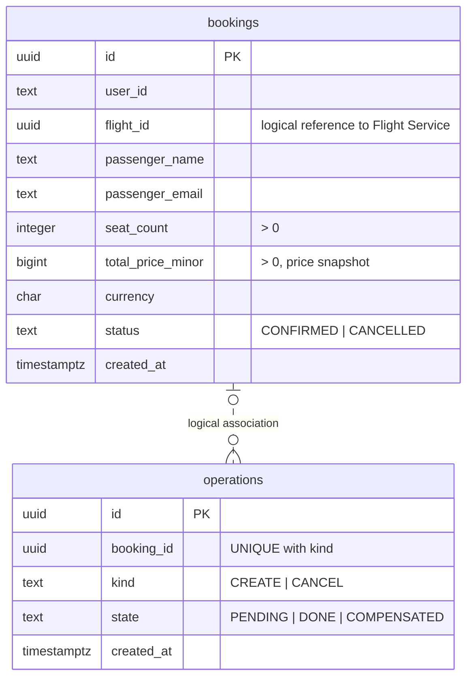

# Схема данных, 3NF

Готовые изображения для просмотра без Mermaid: [Flight](er-flight.svg), [Booking](er-booking.svg).

## Flight Service — PostgreSQL flights

## Booking Service — PostgreSQL bookings

Между БД нет SQL foreign key и прямых обращений сервисов к чужим таблицам.
`bookings.id` ↔ `seat_reservations.booking_id` — логическая связь 1:1 для успешно
созданного бронирования. UNIQUE на booking_id исключает вторую резервацию.
Неуспешная операция может оставить RELEASED-резервацию без Booking для аудита.
`operations` не имеет FK на Booking: намерение CREATE сохраняется до его создания.
`reservation_fences` хранит отменённые booking_id, даже если ReserveSeats ещё не дошёл.
EXPIRED предусмотрен контрактом и CHECK; автоматическое истечение не входит в задание.

Все поля атомарны; неключевые атрибуты зависят от ключа своей сущности.
Название авиакомпании вынесено в airlines: отсутствует транзитивная зависимость
flight_id → airline_code → airline_name внутри flights.
Данные пассажира — снимок конкретного бронирования, user_id обозначает заказчика,
который может покупать билеты разным пассажирам. Поэтому user_id не определяет имя/email.
Стоимость Booking — исторический снимок; актуальная цена Flight в Booking не дублируется.
Счётчик available_seats хранится по условию задания и поддерживается транзакционно;
он является агрегатом резерваций, а не транзитивной зависимостью полей одной таблицы.

Ограничения и индексы реализованы в `db/*/001_initial.sql`: положительные места и цены,
диапазон available_seats, допустимые статусы, IATA-коды, разные аэропорты,
arrival_time > departure_time. Уникальность номера и даты реализована expression index
по UTC-дате departure_time, без дублирующей колонки даты.
В каждой БД есть техническая schema_migrations(version PK, checksum, applied_at).
