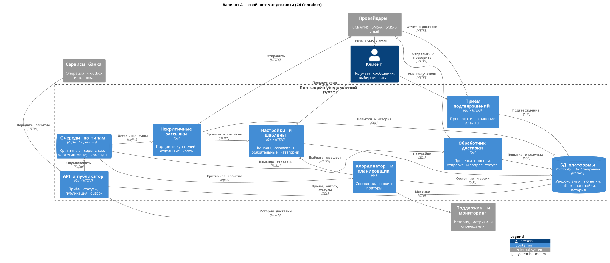
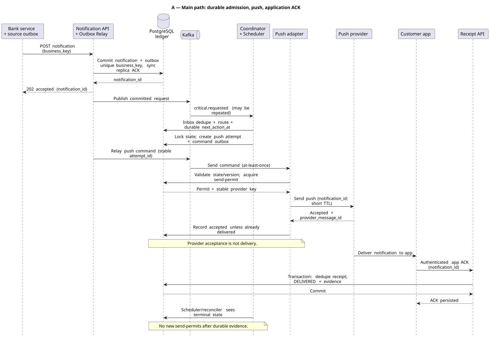
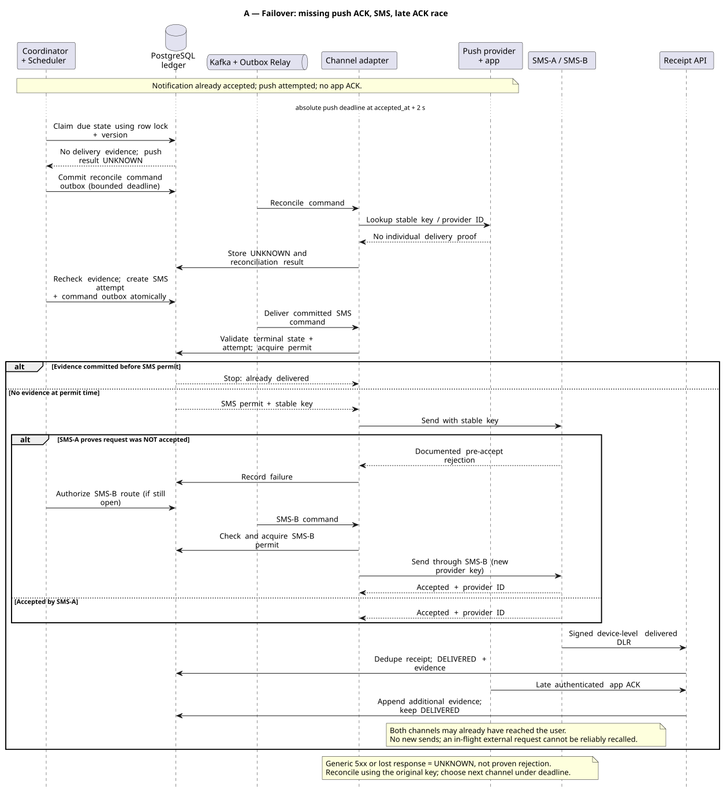
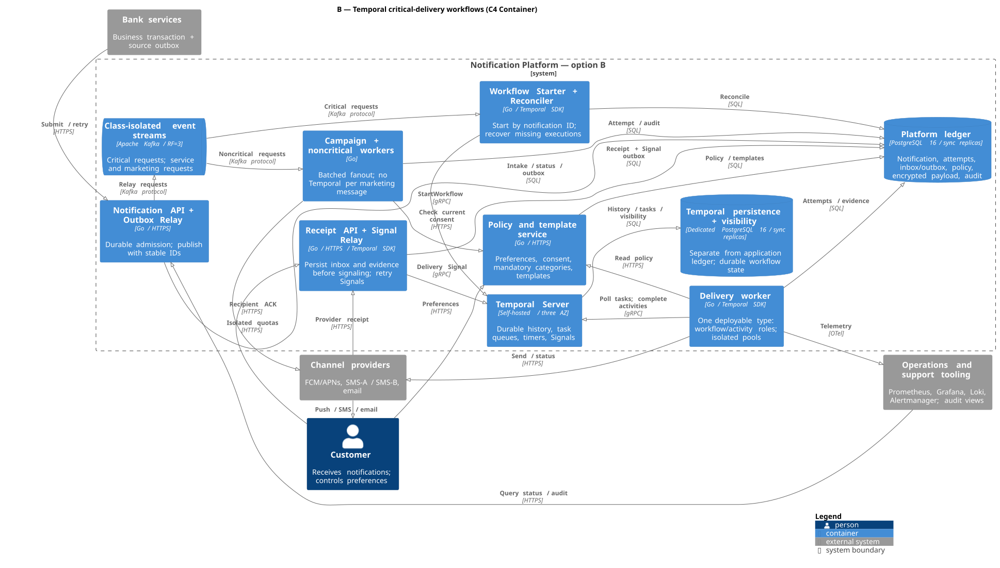
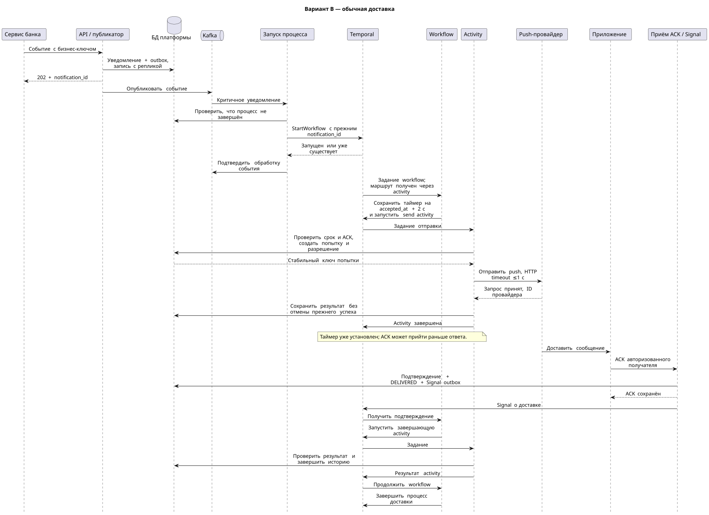
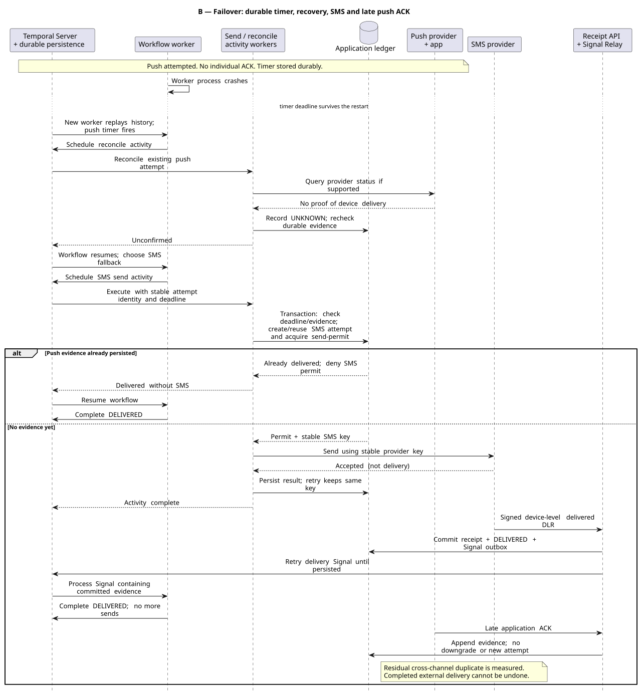

# RFC: Гарантированная доставка критичных уведомлений с кросс-канальным failover

| Метаданные | Значение |
|---|---|
| **Статус** | DRAFT |
| **Автор(ы)** | Милова Ирина Валерьевна |
| **Ответственный** | Милова Ирина Валерьевна |
| **Бизнес-заказчик** | Не назначен: учебный проект |
| **Ревьюеры** | Не назначены; ревью не проводилось |
| **Дата создания** | 2026-11-07 |
| **Дата обновления** | 2026-11-09 |

---

## Оглавление

1. [Контекст](#контекст)
2. [Продуктовый анализ](#продуктовый-анализ)
3. [Пользовательские сценарии](#пользовательские-сценарии)
4. [Статистика](#статистика)
5. [Требования](#требования)
6. [Варианты решения](#варианты-решения)
7. [Сравнительный анализ](#сравнительный-анализ)
8. [Выводы](#выводы)
9. [Связанные задачи](#связанные-задачи)
10. [Приложения](#приложения)

---

## Контекст

Сейчас команды банка отправляют сообщения независимо. Из-за этого трудно контролировать задержки, повторы и недоставленные уведомления. RFC описывает наиболее критичную часть общей платформы: подтверждения переводов, списаний и сообщения безопасности.

Решение охватывает приём, отправку, переключение каналов, повторы и учёт результата. Сервисные и маркетинговые сообщения тоже проходят платформу, но не должны занимать ресурсы критичного потока. Проведение самих банковских операций остаётся за их исходными сервисами.

### Ключевые вопросы

- Как сохранить принятое уведомление и продолжить доставку после сбоя?
- Когда переключить канал, если результат первой отправки неизвестен?
- Как отделить критичный поток от кампаний и объяснить результат клиенту и поддержке?

---

## Продуктовый анализ

Платформа нужна клиентам, командам банковских продуктов, маркетологам и поддержке. Единая доставка должна уменьшить задержки, повторы и число обращений.

| Бизнес-цель | Оценка результата |
|---|---|
| Рост retention на 15% | Относительный рост D30, например с 40% до 46%; сравнение групп пользователей |
| Снижение жалоб на 30% | Сравнение обращений об уведомлениях при сопоставимом объёме отправок |
| Гарантированная критичная доставка | Сохранность принятых сообщений, подтверждения и восстановление по NFR-02/03/10 |

Критичные сообщения о деньгах и безопасности обязательны. Пользователь выбирает первый канал; сервисные категории можно отключить, маркетинг требует согласия. Push выбран первым по умолчанию ради стоимости; сроки, резервные каналы и границы гарантии описаны ниже.

---

## Пользовательские сценарии

| Приоритет | Тип сценария | Действующее лицо | Сценарий |
|---|---|---|---|
| MUST HAVE | Транзакционный | Клиент | Получает подтверждение перевода; при недоступности первого канала включается резерв |
| MUST HAVE | Интеграция | Сервис банка | Передаёт событие и получает ID; повтор запроса возвращает прежний ID |
| MUST HAVE | Настройки | Клиент | Выбирает первый канал, отключает сервисные категории и отзывает маркетинговое согласие |
| MUST HAVE | Кампания | Маркетолог | Планирует или останавливает рассылку до 1 млн пользователей с учётом согласия и лимитов |
| MUST HAVE | Поддержка | Сотрудник поддержки | Видит попытки, подтверждения и причину недоставки |
| MUST HAVE | Восстановление | Дежурный сотрудник | Получает оповещение о просроченной доставке и продолжает обработку с прежними ключами |

**Приоритеты:** MUST HAVE — обязательно; SHOULD HAVE — желательно; COULD HAVE — опционально. В таблицах требований ниже все перечисленные возможности включены в обязательный объём проекта.

---

## Статистика

| Показатель из условия | Значение |
|---|---|
| MAU | 10 млн пользователей |
| DAU | 3 млн пользователей |
| Одновременно активные пользователи | До 300 тыс. |
| Уведомления на пользователя в сутки | 2 транзакционных, 3 сервисных, 5 маркетинговых |
| Размер массовой кампании | До 1 млн получателей |

Это исходные данные задания. Реальные пики, доли подтверждений и стоимость провайдеров пока не измерены; допущения для расчётов указаны отдельно.

---

## Требования

Основание — [требования к платформе](requirements.md), задания 1–7. Обозначения FR, NFR и ASR сохранены для связи документов.

### Функциональные требования

| № | Приоритет | Обозначение | Требование |
|---|---|---|---|
| 1 | MUST HAVE | FR-01 | Команды банка передают все типы уведомлений через единую платформу и получают идентификатор и статус сообщения. Доступны push, SMS и email. |
| 2 | MUST HAVE | FR-02 | Критичные сообщения обслуживаются раньше массовых рассылок. Кампания не должна задерживать уведомление о списании. |
| 3 | MUST HAVE | FR-03 | Пользователь выбирает первый канал и отключает разрешённые категории. Обязательность критичных сообщений и порядок резервной доставки ему объясняются. |
| 4 | MUST HAVE | FR-04 | При отказе или отсутствии подтверждения основного канала платформа автоматически пробует резервный для критичного уведомления. |
| 5 | MUST HAVE | FR-05 | Повторная передача одного бизнес-события не создаёт новое уведомление. После подтверждения новые отправки останавливаются. |
| 6 | MUST HAVE | FR-06 | Поддержка видит историю попыток, результат и причину проблемы с доставкой. |
| 7 | MUST HAVE | FR-07 | Маркетолог планирует, останавливает и проверяет кампанию до 1 млн получателей. Учитываются актуальное согласие, ограничения частоты и тихие часы. |
| 8 | MUST HAVE | FR-08 | Уведомления используют согласованные шаблоны и язык клиента. В критичном сообщении есть время операции и ссылка на подробности в банке. |
| 9 | MUST HAVE | FR-09 | Если критичная доставка не подтверждена, система продолжает восстановление и сообщает ответственному сотруднику. |
| 10 | MUST HAVE | FR-10 | При соблюдении срочности и предпочтений выбирается более дешёвый канал. Расходы доступны по каналам и кампаниям. |

### Нефункциональные требования

Время приёма измеряется от запроса до ответа, отправки и доставки — от `accepted_at`. Все численные значения ниже — проектные цели.

| № | Приоритет | Обозначение | Требование |
|---|---|---|---|
| 1 | MUST HAVE | NFR-01 | Приём: p99 ≤200 мс. Первая передача критичного сообщения провайдеру: p99 ≤1 с при нагрузке NFR-04. |
| 2 | MUST HAVE | NFR-02 | За 30 дней ≥99% критичных сообщений подтверждаются за 5 с, ≥99,95% — за 60 с. |
| 3 | MUST HAVE | NFR-03 | Доступность приёма ≥99,99% в месяц. При потере одного узла или зоны доступности: RPO=0, RTO ≤60 с. |
| 4 | MUST HAVE | NFR-04 | Принимать 10 000 новых сообщений/с, включая 2 100 критичных/с, в течение часа. Первые попытки кампании на 1 млн — за ≤30 минут при доступных квотах. |
| 5 | MUST HAVE | NFR-05 | 100 повторов события дают одно уведомление. После подтверждения — 0 новых разрешений на отправку. Цель по наблюдаемым межканальным дублям — <0,1% критичных за 30 дней. |
| 6 | MUST HAVE | NFR-06 | Изменение настроек учитывается перед новой отправкой за ≤60 с, p99. Маркетинг без подтверждённого согласия не отправляется. |
| 7 | MUST HAVE | NFR-07 | Для 100% критичных сохраняется история. Запись подтверждения: p99 ≤300 мс. Оповещение о превышении 60 с — в следующие ≤2 минуты. |
| 8 | MUST HAVE | NFR-08 | Соединения шифруются и аутентифицируются; обращения к содержимому аудируются. После завершения содержимое удаляется за ≤30 дней, метаданные — через 90 дней. |
| 9 | MUST HAVE | NFR-09 | В штатной группе с первым каналом push SMS требуется не более чем для 10% критичных. Отчёт затрат — ежедневно, расхождение со счетами ≤1%. |
| 10 | MUST HAVE | NFR-10 | После 15 минут временного отказа всех каналов ≥95% накопленных критичных получают повторную отправку за 15 минут после восстановления хотя бы одного канала. |

### Архитектурно значимые требования

| ASR | Приоритет | Что требуется от доставки |
|---|---|---|
| ASR-01 | P0 | Первая отправка p99 ≤1 с; ≥99% подтверждений за 5 с независимо от кампаний |
| ASR-02 | P0 | Не терять принятое при потере одной зоны; ≥99,95% подтверждений за 60 с; сохранять повторы |
| ASR-03 | P0 | Одно бизнес-событие — одно уведомление; согласовать подтверждение и переключение каналов |
| ASR-04 | P1 | Выдержать 10 000 новых сообщений/с, включая 2 100 критичных/с, с контролем SMS-расходов |
| ASR-05 | P0 | Учесть предпочтения, обязательные категории, согласие и защиту содержания |
| ASR-06 | P1 | Сохранять историю попыток и замечать незавершённые доставки |

Цели подтверждения измеряются за 30 дней по всем принятым валидным критичным сообщениям. Их достижимость у реальных пользователей нужно проверить пилотом; ниже приведён архитектурный расчёт, а не результат испытаний.

### Границы гарантии

Здесь важно различать три события:

1. **Платформа приняла сообщение:** запись уведомления и задания на обработку сохранена с репликой; после этого возвращается `202`.
2. **Провайдер принял запрос:** он выдал идентификатор отправки. Получатель мог ещё ничего не получить.
3. **Доставка подтверждена:** пришло доказательство получения, определённое для канала.

ACK — подтверждение от приложения или получателя; DLR — отчёт SMS-провайдера о доставке. Их получение и обработку нельзя заменять успешным HTTP-ответом на отправку.

| Канал | Достаточное подтверждение | Ограничение |
|---|---|---|
| Push | ACK авторизованного приложения с `notification_id` после получения сообщения | Не доказывает, что человек прочитал сообщение |
| SMS | Подлинный DLR `delivered`, который по контракту означает доставку на устройство | Приём только сетью/SMSC недостаточен; DLR может запаздывать |
| Email | Явный ACK авторизованного получателя после перехода из письма в банк и получения содержания | Приём письма почтовым сервером и tracking pixel не доказывают получение пользователем |

Обычный email delivery event сохраняется как `EMAIL_SERVER_ACCEPTED`, но не переводит уведомление в `DELIVERED`. Если сильного подтверждения нет, процесс остаётся открытым: продолжаются сверка, резервная доставка и оповещение ответственного.

Платформа гарантирует сохранение принятого сообщения при отказе процесса, узла или одной зоны доступности и продолжение обработки после восстановления. При доступном канале, действующем контакте и достаточной квоте она добивается доставки хотя бы одним путём. Полностью отключённое устройство или бесконечный отказ всех каналов не позволяют обещать конечный срок. Такие случаи считаются недоставкой и нарушением SLO, а не исключаются из статистики.

**Расчёт нагрузок:**

#### Количество сообщений

В условии: MAU — 10 млн, DAU — 3 млн, одновременно активны до 300 тыс. Для расчёта принято допущение: суточные нормы относятся к DAU, поэтому ежедневный поток рассчитывается по 3 млн пользователей. Число одновременных пользователей само по себе не является числом сообщений в секунду.

| Тип | Расчёт в сутки | Среднее, сообщений/с | Пик при ×10 |
|---|---:|---:|---:|
| Транзакционные | 3 млн ×2 =6 млн | 69,4 | 694,4 |
| Сервисные | 3 млн ×3 =9 млн | 104,2 | 1 041,7 |
| Маркетинговые | 3 млн ×5 =15 млн | 173,6 | 1 736,1 |
| Всего | 30 млн | 347,2 | 3 472,2 |

Среднее получено делением на 86 400. Коэффициент пика ×10 принят как допущение и требует проверки по данным банка.

Кампания на 1 млн за 30 минут требует около **556 первых отправок/с**; при разворачивании за 10 минут — 1 667/с. Если добавить её к фоновому пику, получается около **5 139 новых сообщений/с**. Поэтому целевые 10 000/с дают запас; для критичных отдельно резервируется 2 100/с. Согласие и частотные ограничения могут уменьшить поток, но в расчёте это уменьшение не учитывается.

#### Резервные попытки и расходы

Для оценки принят сценарий с первым каналом push у всех пользователей: 92% получают быстрый push ACK, 8% требуют SMS, 1% исходного потока доходит также до email. Тогда на сообщение приходится `1 +0,08 +0,01 =1,09` отправки: **6,54 млн критичных попыток и 480 тыс. SMS в сутки**, без технических повторов. Другие предпочтения изменят эти доли.

Эти доли не доказывают SLO доставки. В консервативной оценке без поздних push ACK, если 92% сообщений подтверждаются push до 2 с, для общего результата 99% за 5 с резерв должен подтвердить `(0,99 − 0,92) / 0,08 = 87,5%` оставшихся сообщений к этому сроку. Для 99,95% за 60 с нужно 99,375% оставшихся; достижимость проверяется пилотом, включая офлайн-получателей.

При полном отказе push весь критичный поток переходит в SMS. Каждый из двух SMS-поставщиков должен иметь квоту на 2 100/с; на восстановление накопившейся за 15 минут очереди по NFR-10 нужен запас до 4 200/с с текущим потоком. Без такой квоты увеличение числа обработчиков проблему не решит. Аналогичный резерв нужен email, если доступен только он.

Штатная SMS-стоимость — `480 000 × цена SMS`, при суточном отказе push — `6 000 000 × цена SMS`, то есть в 12,5 раза выше. Пользователи с первым каналом SMS считаются отдельно. Превышение аварийного бюджета требует оповещения, но не автоматической остановки критичной доставки.

Push выбран первым по умолчанию из-за низкой стоимости и быстрого ACK. Email тоже дешевле SMS, но его сильное подтверждение обычно медленнее, поэтому срочным резервом выбран SMS. Это компромисс между ценой и сроком; предпочтительный канал пользователя всё равно остаётся первым.

#### Нагрузка на хранилища

При размере события 1 КБ вход составляет около 30 ГБ/сутки. Для Kafka с хранением 7 дней и тремя репликами это **630 ГБ**. В A добавляются 6,54 млн команд отправки в сутки — суммарно около **767 ГБ**; в B их обрабатывает Temporal. Накладные расходы и технические повторы требуют дополнительного запаса.

Если метаданные уведомления занимают около 0,5 КБ, PostgreSQL получает примерно **15 ГБ новых данных в сутки**, без содержимого и истории попыток. Обновления статусов и подтверждения увеличивают нагрузку записи. Данные разделяются по дате; необходимость шардирования проверяется на целевом потоке.

У B есть отдельная цена истории: при условных 30 событиях на процесс — **180 млн событий в сутки**. При 1 КБ на событие и хранении завершённой истории 7 дней получается около **1,26 ТБ** до репликации. Поэтому Temporal используется только для критичных, а точные мощности выбираются после измерений.

---

## Варианты решения

Общая часть обоих вариантов:

Источник сохраняет банковское событие вместе с записью outbox — заданием, которое можно повторно отправить после сбоя. Событие остаётся у источника до получения `202`; при потере ответа запрос повторяется с прежним бизнес-ключом. API уведомлений в одной транзакции сохраняет уведомление и свой outbox. После подтверждения записи с синхронной репликой возвращается `202`; фоновый публикатор отправляет задание в Kafka. Публикация может повториться, поэтому дальнейшая обработка идемпотентна.

Основной стек: **Go, Kafka, PostgreSQL 16**, синхронные реплики PostgreSQL с Patroni/etcd в трёх зонах. Kafka: `critical.requested`, `service.requested`, `marketing.requested`, три реплики, `acks=all`, `min.insync.replicas=2`; выбор заведомо отставшего лидера запрещён. В A есть также `critical.commands`. Удаление старого события Kafka не удаляет незавершённое уведомление из БД.

У критичных и массовых сообщений отдельные очереди, пулы обработчиков, соединения БД и квоты провайдеров. Маркетинговая кампания разворачивается порциями с проверкой согласия. При общей нехватке ресурсов ограничивается маркетинг, а не критичный поток.

В C4 API и фоновый публикатор объединены в один сервис, как и координатор с планировщиком. Сервис подтверждений в B также отправляет Signal. Обработчики доставки запускаются отдельными пулами по роли и каналу. Общая БД хранит уведомления, попытки, настройки, шаблоны и содержимое; инструменты наблюдения показаны внешней системой.

Правила каналов, идентификаторов, повторов и подтверждений одинаковы для обоих вариантов и приведены в [приложениях](#приложения).

Сроки ниже — предварительные оценки реализации подсистемы, а не сроки задания или обещание банка. Они предполагают доступные контракты провайдеров и разработку двумя backend-разработчиками с участием SRE и QA. Ожидание внешних согласований оценивается отдельно.

### Вариант 1: Автомат доставки на Kafka и PostgreSQL

**Описание:** Собственный координатор хранит состояние в PostgreSQL и передаёт команды через Kafka.

#### Архитектура

[Исходник C4-PlantUML](diagrams/a-container.puml).

Координатор читает критичные события и сохраняет состояние доставки в PostgreSQL; чтение Kafka подтверждается только после сохранения. Повтор события возвращает прежнее состояние. Планировщик находит наступившие `next_action_at`, короткой транзакцией блокирует запись, выдаёт временное право обработки и записывает команду в outbox. Для конкурентных обработчиков используются `FOR UPDATE SKIP LOCKED` и версия состояния. Во время внешнего HTTP транзакция не удерживается.

Обработчик на Go получает команду из Kafka, проверяет актуальность попытки и отсутствие подтверждения, затем отправляет сообщение. Сервис подтверждений проверяет входящий callback, сохраняет его и обновляет состояние в той же БД. Просроченное право обработки запускает сверку результата, а не слепую отправку заново.

**Обычная доставка:** после устойчивого приёма создаётся push-попытка; провайдер принимает её, приложение получает сообщение и возвращает ACK. Только после ACK уведомление становится `DELIVERED`.

[PlantUML](diagrams/a-main.puml).

**Failover:** через 2 с без push ACK планировщик проверяет сохранённый результат и при необходимости выдаёт SMS-команду. Если ACK успел записаться до выдачи разрешения, SMS не запускается. При доказанном отказе SMS-A можно выбрать SMS-B. Поздний push ACK после SMS сохраняется в истории.

[PlantUML](diagrams/a-failover.puml).

#### Этапы реализации

| Этап | Описание | Планируемый срок | Ресурсы | Риски |
|---|---|---|---|---|
| 1 | Контракты каналов, входной API, outbox и БД | Недели 1–2 | 2 backend-разработчика, SRE | Неоднозначные подтверждения провайдеров |
| 2 | Автомат, планировщик, адаптеры и подтверждения | Недели 3–4 | 2 backend-разработчика | Гонки таймеров, блокировок и ACK |
| 3 | Нагрузочные испытания, отказы и пилот | Недели 5–6 | Backend-команда, SRE, QA | Превышение задержки и нехватка квот |

#### Преимущества

- Используется общий Kafka/PostgreSQL-стек без дополнительного движка.
- Состояние доставки доступно в БД; поведение планировщика можно точно настроить.

#### Недостатки

- Таймеры, восстановление временных блокировок и гонки реализуются самостоятельно.
- Ошибка автомата может привести к дублю или потере ожидания; масштабирование зависит от нагрузки БД.

---

### Вариант 2: Workflow на Temporal

**Описание:** Temporal управляет устойчивыми таймерами и выполнением процесса; БД платформы хранит результат доставки.

#### Архитектура

[Исходник C4-PlantUML](diagrams/b-container.puml).

Получив событие Kafka, сервис запуска создаёт workflow `critical/<notification_id>` с `WorkflowIDReusePolicy=REJECT_DUPLICATE` и подтверждает чтение Kafka только после ответа Temporal. Повторный старт с тем же ID не создаёт второй процесс; уже существующий процесс считается успешно запущенным. После удаления завершённой истории от повтора защищает состояние завершения в общей БД. Аварийно завершённый незаконченный процесс восстанавливается отдельно, с проверкой сохранённого состояния и прежних ключей попыток.

Workflow хранит порядок шагов, таймеры и ожидание подтверждений. Внешние операции выполняют activities через Go SDK: чтение политики, работа с БД и вызов провайдера. Сам workflow не обращается к БД и провайдерам напрямую: при восстановлении он повторяет решения из записанной истории.

Перед send activity устанавливается устойчивый таймер на `accepted_at +2 с`; workflow асинхронно ждёт результат, Signal или таймер. HTTP ограничен 1 с, activity — оставшимся бюджетом шага. Для внешней отправки `MaximumAttempts=1`, скрытые SDK retries отключены: решение о повторе принимает workflow с прежним ключом попытки.

Сервис подтверждений сначала сохраняет подтверждение и Signal outbox в PostgreSQL. Фоновый публикатор повторяет отправку Signal в Temporal. Перед каждой новой отправкой activity проверяет БД, поэтому задержка Signal не разрешает отправку после уже сохранённого ACK. Если callback пришёл раньше старта workflow, он остаётся в outbox; если workflow уже завершён, публикатор проверяет итог в БД и закрывает запись.

Дополнительный стек B — **Temporal Server, Go SDK, отдельный PostgreSQL 16 для persistence и SQL Visibility**. Пулы `critical-orchestration`, `critical-push`, `critical-sms`, `critical-email` разделены. БД результата доставки и история исполнения не имеют общей транзакции: разрыв закрывают outbox, повторяемые activities и сверка. Длительные процессы используют Continue-As-New, сохраняя прежний notification ID и ссылки на попытки. Некритичные сообщения остаются на обычных обработчиках Kafka.

**Обычная доставка:** workflow создаёт попытку, отправляет push и ждёт ACK. После сохранения ACK в БД приходит Signal, завершающий процесс.

[PlantUML](diagrams/b-main.puml).

**Failover:** таймер переживает перезапуск обработчика. После срабатывания activity проверяет результат и, если подтверждения нет, начинает SMS. Подтверждённый SMS завершает процесс, поздний push ACK только дополняет историю.

[PlantUML](diagrams/b-failover.puml).

#### Этапы реализации

| Этап | Описание | Планируемый срок | Ресурсы | Риски |
|---|---|---|---|---|
| 1 | Контракты каналов, общий вход и кластер Temporal | Недели 1–2 | 2 backend-разработчика, SRE | Недостаток опыта эксплуатации Temporal |
| 2 | Workflow, activities, адаптеры и Signal outbox | Недели 3–4 | 2 backend-разработчика | Неатомарность истории исполнения и результата доставки |
| 3 | Нагрузочные испытания, отказы и пилот | Неделя 5 | Backend-команда, SRE, QA | Нагрузка на persistence и задержки очередей |

#### Преимущества

- Движок сохраняет таймеры и восстанавливает исполнение после сбоя.
- Меньше собственного кода для ожидания подтверждений и переходов между каналами.

#### Недостатки

- Нужны отдельный кластер, хранение истории и совместимое версионирование процессов.
- Temporal сам по себе не устраняет внешние дубли: стабильные ключи, адаптеры и сверка всё равно нужны.

---

## Сравнительный анализ

### Ресурсные требования

| Критерий | Вариант 1 | Вариант 2 |
|---|---|---|
| Время реализации | Около 6 недель | Около 5 недель при наличии опыта Temporal |
| Команда | 2 backend-разработчика; SRE и QA на соответствующих этапах | Такой же состав; нужен опыт Temporal |
| Инфраструктура | Общий Go/Kafka/PostgreSQL-стек, собственный планировщик и обработчики | Общий стек плюс Temporal Server, отдельный PostgreSQL для persistence и SQL Visibility |
| Организационные риски | Разработка и сопровождение собственного надёжного автомата | Обучение команды, эксплуатация Temporal и совместимость версий workflow |

Оценки времени и команды требуют уточнения после прототипов. Расчёты данных и квот приведены в требованиях; число серверов определяется нагрузочными испытаниями.

### Соответствие требованиям

| Требование | Вариант 1 | Вариант 2 |
|---|---|---|
| FR-01 | Единый API и outbox | Тот же общий вход |
| FR-02 | Отдельные очереди и обработчики | Отдельные очереди заданий и пулы |
| FR-03 | Сервис настроек и обязательная политика | Те же проверки через activities |
| FR-04 | Планировщик переключает каналы | Workflow и устойчивые таймеры |
| FR-05 | Бизнес-ключ, версия и разрешение отправки | Workflow ID и те же ограничения БД |
| FR-06 | История попыток и подтверждений | Та же история плюс история исполнения |
| FR-07 | Общий обработчик кампаний вне критичного потока | Тот же обработчик без Temporal |
| FR-08 | Общие шаблоны и настройки | Те же шаблоны и настройки |
| FR-09 | Сверка открытых сообщений и оповещения | Сверка, восстановление workflow и оповещения |
| FR-10 | Push первым по умолчанию, учёт расходов | Та же политика стоимости |
| NFR-01 | Цель: короткий цикл планировщика и изоляция | Цель: изоляция и ограничение задержки workflow/activity |
| NFR-02 | Цель: резерв по сроку и подтверждения каналов | Цель: устойчивые таймеры и те же подтверждения |
| NFR-03 | Синхронные реплики и восстановление автомата | Те же реплики плюс устойчивая БД Temporal |
| NFR-04 | Цель: масштабирование Kafka, обработчиков и БД | Цель: дополнительно масштабируются Temporal и его БД |
| NFR-05 | Уникальные ключи и атомарные разрешения | Те же ключи и сериализация решений workflow |
| NFR-06 | Проверка актуальных настроек перед отправкой | Та же проверка в activity |
| NFR-07 | Общая история и метрики | Общая история плюс история workflow |
| NFR-08 | Шифрование, права и удаление данных | То же; в history только ID и ссылки |
| NFR-09 | Push-first политика и отчёт расходов | Та же политика и отчёт |
| NFR-10 | Сохранённая очередь и двойная квота | Устойчивые процессы и та же квота |

Для показателей задержки, доступности и пропускной способности таблица описывает механизм выполнения, а не подтверждённый результат тестов. Нужны нагрузочные испытания и пилот с реальными каналами. Ограничения внешних дублей сохраняются в обоих вариантах.

#### Соответствие ASR

| ASR | Вариант 1: собственный автомат | Вариант 2: Temporal |
|---|---|---|
| ASR-01 | Отдельный критичный поток, короткий цикл планировщика, свои обработчики и квоты | Отдельные очереди заданий и обработчики; время workflow/activity входит в тот же бюджет задержки |
| ASR-02 | PostgreSQL хранит состояние, сроки и outbox; код восстанавливает просроченные обработки | Temporal хранит таймеры/историю; общая БД и outbox защищают результат и приём |
| ASR-03 | Уникальные ключи, версия записи, атомарное разрешение и учёт подтверждений | Workflow ID и последовательные решения плюс те же ключи в БД и у провайдера; внешние дубли остаются возможны |
| ASR-04 | Масштабирование обработчиков Kafka и БД; меньше дополнительной инфраструктуры | Масштабирование обработчиков workflow и activities; больше записей истории, поэтому только критичные идут в Temporal |
| ASR-05 | Проверка политики, согласия и прав перед отправкой | Те же проверки выполняются activities; в историю передаются ID и ссылки вместо содержания |
| ASR-06 | Общая история, сверка незавершённых и метрики | То же плюс история workflow; после её удаления история доставки остаётся в БД |

---

## Выводы

**Рекомендация:** вариант 2 — workflow на Temporal (B на диаграммах).

**Обоснование выбора:**

Выбран **вариант 2 (B)**: готовые таймеры и восстановление Temporal уменьшают риск ошибок в собственном планировщике. Цена — дополнительная инфраструктура, хранение истории и совместимость версий workflow. Выбор предполагает опыт сопровождения Temporal; без него вариант A может оказаться разумнее. Преимущество B — меньший риск реализации, а не доказанная экономия или скорость.

Основные компромиссы: короткий таймер push ускоряет резерв, но увеличивает SMS-расходы и повторы; синхронная репликация защищает запись, но может временно блокировать приём. Требования к квотам и остаточный риск внешних дублей одинаковы для обоих вариантов. При недостижимых контактах получение к фиксированному сроку не гарантируется.

До внедрения нужно проверить скорость SMS DLR, долю офлайн-получателей, реальные пики, резервные квоты и стоимость Temporal — контрактами, пилотом и сравнением прототипов.

---

## Связанные задачи

Задачи во внешнем трекере не заведены. Для реализации потребуется:

| Задача | Результат |
|---|---|
| Контракты каналов | Подтверждённые ACK/DLR, идемпотентность, квоты и резервные поставщики |
| Общая платформа | API, outbox, настройки, шаблоны и история |
| Критичная доставка | Выбранный workflow, activities, таймеры и переключение каналов |
| Проверка и пилот | Измеренные задержки, восстановление, расходы и постепенное подключение источников |

---

## Приложения

### Глоссарий

| Термин | Определение |
|---|---|
| ASR | Требование, существенно влияющее на архитектуру |
| SLO | Целевой уровень качества сервиса |
| p99 | Значение, в которое укладываются 99% измерений |
| RPO / RTO | Допустимая потеря данных / срок восстановления |
| ACK / DLR | Подтверждение приложения или получателя / отчёт о доставке SMS |
| Failover | Переключение на резервный канал при отказе или отсутствии подтверждения |
| Outbox | Сохраняемое вместе с данными задание для надёжной публикации после сбоя |
| Workflow / activity | Устойчивый процесс Temporal / выполняемая им внешняя операция |
| A / B | Варианты 1 / 2; буквенные обозначения сохранены на диаграммах |

### Протокол доставки

#### Идентификаторы и состояние

Бизнес-ключ: `(producer_id, business_event_id, recipient_id, purpose)`. Он различает, например, уведомления отправителю и получателю одного перевода. Повтор с тем же ключом возвращает прежний `notification_id`, а с другим содержанием — `409`. Ключ хранится отдельно от дневных разделов таблицы; попытки и подтверждения связываются с тем же уведомлением.

Основные состояния: `ACCEPTED → ROUTING → SENDING → WAITING_RECEIPT → DELIVERED`. При проблеме добавляются `RETRY_WAIT` и `UNKNOWN` у попытки. После 60 с без подтверждения уведомление отмечается `OVERDUE`, но обработка продолжается. Неустранимую недоставку можно закрыть только как отдельный неуспешный результат с причиной, а не как `DELIVERED`.

Ключ попытки `notification_id:attempt_ordinal:provider` сохраняется до HTTP и не меняется при техническом retry. Срок его хранения у провайдера должен покрывать повторы; после истечения срока попытка с неизвестным результатом требует сверки, а не слепой повторной отправки. Подтверждения дедуплицируются по провайдеру и receipt ID. В раннем callback провайдер должен вернуть `client_reference` попытки. Иначе подтверждение сохраняется до получения ID провайдера и достоверного связывания.

#### Каналы и сроки

Критичные сообщения обязательны; выбор пользователя задаёт первый канал, но не отключает резерв. При недоступности сервиса настроек используется последняя валидная обязательная политика и известные подтверждённые контакты. Если контактов нет, это открытая проблема маршрутизации с оповещением ответственного. Маркетинг при невозможности проверить согласие блокируется.

| Ситуация | Действие |
|---|---|
| Первый канал — push | Push; при явном отказе — резерв сразу, без ACK до 2 с — сверка и SMS |
| SMS-A доказанно не принял запрос | Попробовать SMS-B; у обоих поставщиков отдельные ключи |
| SMS не подтверждена к 10 с | Проверить статус и подключить email; его приём сервером не закрывает процесс |
| Пользователь выбрал SMS/email первым | Начать с него; без подтверждения за 2 с перейти к оставшимся доступным каналам, начиная с push |
| Все маршруты исчерпаны | Продолжать сверку и восстановительные круги; через 60 с считать SLO нарушенным |

Для допустимых повторов — интервалы 1, 2, 4 с со случайным разбросом, не менее `Retry-After` и ограничений провайдера, до трёх send-вызовов на маршрут в первые 60 с. Они не сдвигают срок failover. После 60 с интервалы увеличиваются от 30 с до 15 минут; восстановление провайдера запускает разбор очереди по NFR-10.

Неверный контакт или доказанный отказ до приёма — ошибка маршрута. Таймаут, обрыв связи после передачи запроса и обычный `5xx` означают `UNKNOWN`: сообщение уже могло быть принято. Сначала используются прежний ключ, запрос статуса и подтверждение провайдера. Новая попытка в том же канале допустима после доказанной неотправки/истечения, а не просто из-за отсутствия ответа. Провайдер с частыми временными ошибками временно исключается из новых маршрутов.

#### Риск дублирования

Подтверждение и выдача нового разрешения на отправку сериализуются в БД. Если ACK записался первым, новая попытка запрещена. Но если SMS-запрос уже ушёл, поздний push ACK не может гарантированно отозвать его. Поэтому при неизвестном результате приходится выбирать между быстрой резервной доставкой и риском повтора; для критичного сообщения приоритетом остаётся доставка.

Риск снижают стабильные ключи, сверка результата, дедупликация в приложении и короткий push TTL, например 5 с. Разные банковские события не объединяются одним collapse key. Поздняя ошибка не отменяет успех. Повторная обработка продолжает прежний процесс. После 90-дневного окна старое событие восстанавливается только с отдельной проверкой; открытый процесс сохраняет ключ до разрешения.

### Надёжность, наблюдаемость и безопасность

Реплики PostgreSQL размещаются в разных зонах. Подтверждённая запись должна быть на синхронной реплике; после отказа выбирается только реплика с нужными данными, старый primary изолируется. При потере безопасного кворума новый приём останавливается, а источники сохраняют outbox. Так выполняется RPO=0 в выбранной модели ценой временного снижения доступности.

Сверка раз в минуту ищет принятые сообщения без процесса, зависшие попытки и неотправленные outbox/Signals. Всё возобновляется с прежними ID. Содержимое завершённых сообщений удаляется по NFR-08; незавершённое сохраняет минимум для повторной доставки.

Для наблюдаемости используются OpenTelemetry, Prometheus/Grafana, Loki и Alertmanager. Идентификаторы уведомления, попытки и отправки провайдера связывают создание, ошибки, переключения и результат. Основные метрики: время первой отправки и подтверждения, размер очереди, возраст старейшего сообщения, UNKNOWN, fallback, наблюдаемые дубли, ошибки/квоты провайдеров и стоимость. Потерянный ACK может скрыть дубль; метрику дополняют жалобы и проверки на контрольных устройствах. После превышения 60 с ответственному отправляется сгруппированное оповещение в срок NFR-07.

Соединения защищены TLS/mTLS, содержимое в БД и резервных копиях шифруется, доступ к нему ограничен и аудируется. Подпись callback и принадлежность app ACK проверяются до изменения результата. Внешние сообщения содержат минимум банковских данных и ссылку на подробности в приложении.

### Проверка и внедрение

Перед внедрением необходимо проверить следующие сценарии. Фактические испытания в рамках архитектурной работы не проводились.

| Сценарий | Ожидаемый результат |
|---|---|
| Целевой поток и кампания на 1 млн одновременно | Сохраняются NFR-01/02/04; очередь критичных сообщений не растёт |
| 100 повторов события, падение после commit до ответа | Один ID; другое содержание с тем же ключом получает 409 |
| Провайдер принял запрос, ответ потерялся | UNKNOWN и сверка с прежним ключом; нет слепого нового ID |
| ACK одновременно с таймером; повторный callback | После сохранённого подтверждения новые разрешения не выдаются; успех не отменяется |
| Отказ push и SMS-A, затем восстановление | Работает резерв; незавершённые сохраняются и обрабатываются по NFR-10 |
| Падение обработчика или одной зоны | Принятые сообщения не теряются, обработка восстанавливается с прежней позиции |
| Email server event без recipient ACK | Нет ложного DELIVERED, восстановление продолжается |
| Отзыв согласия, поддельный callback, чужой ACK | Нет запрещённой отправки или подмены результата |

Источники подключаются постепенно: сначала сравнение маршрутизации без внешних отправок, затем увеличение доли новых событий. У каждого события должен быть один владелец отправки. При откате в старую систему направляются только новые события; уже принятые сообщения платформа доводит до результата с прежними ключами. Изменения workflow должны оставаться совместимыми с историей открытых процессов.

### Источники

Технические свойства сверены с документацией; сроки, объёмы и выбор варианта — допущения и расчёты этой работы.

- [Temporal: Activities](https://docs.temporal.io/activity-definition), [таймауты](https://docs.temporal.io/encyclopedia/detecting-activity-failures), [Workflow ID](https://docs.temporal.io/workflow-execution/workflowid-runid), [SQL Visibility](https://docs.temporal.io/visibility), [Continue-As-New](https://docs.temporal.io/develop/go/workflows/continue-as-new).
- [Kafka: Design](https://kafka.apache.org/41/design/design/) — границы exactly-once при работе с внешними системами.
- [Firebase: доставка](https://firebase.google.com/docs/cloud-messaging/understand-delivery), [TTL](https://firebase.google.com/docs/cloud-messaging/customize-messages/setting-message-lifespan), [ошибки и повторы](https://firebase.google.com/docs/cloud-messaging/error-codes).
- [PostgreSQL: синхронная репликация](https://www.postgresql.org/docs/16/warm-standby.html#SYNCHRONOUS-REPLICATION).
